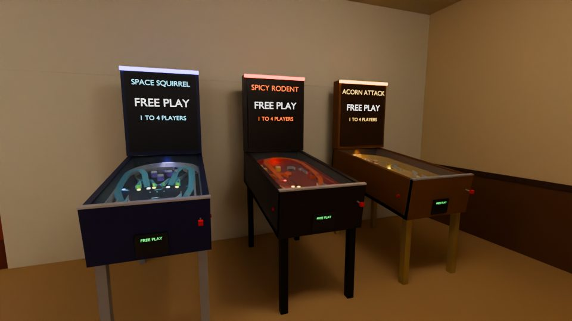
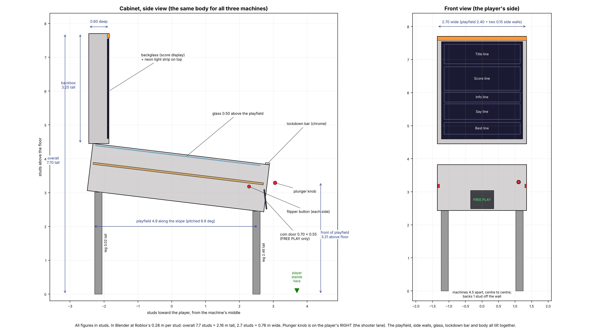
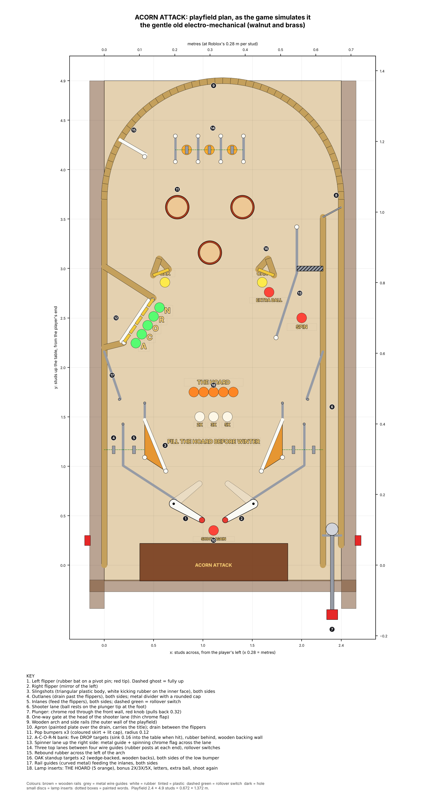
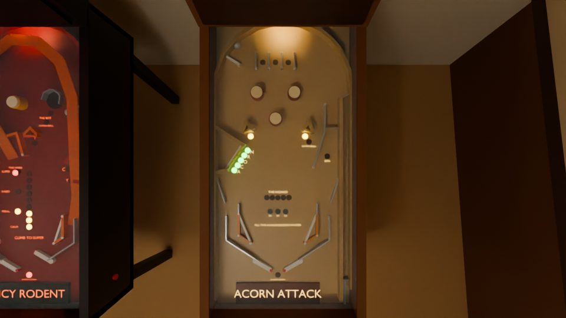
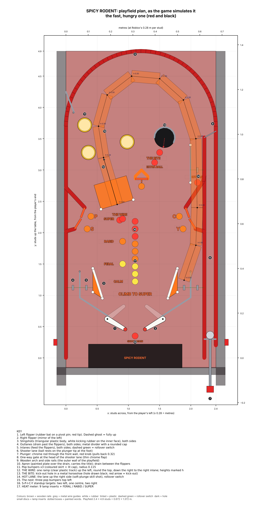
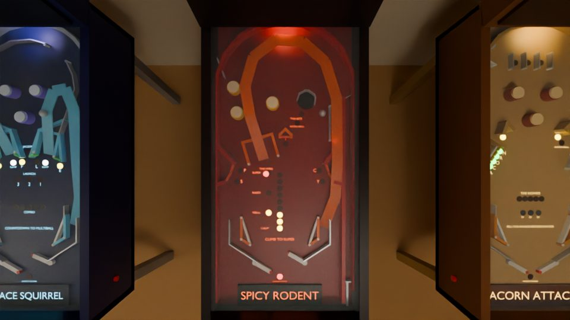
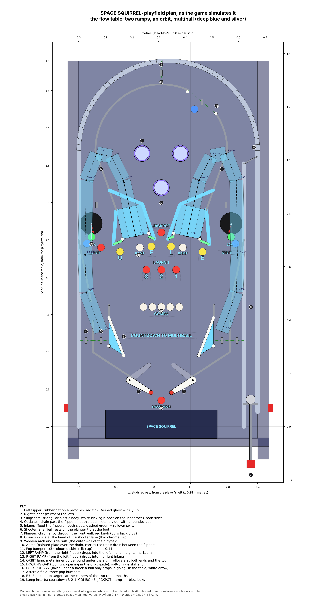
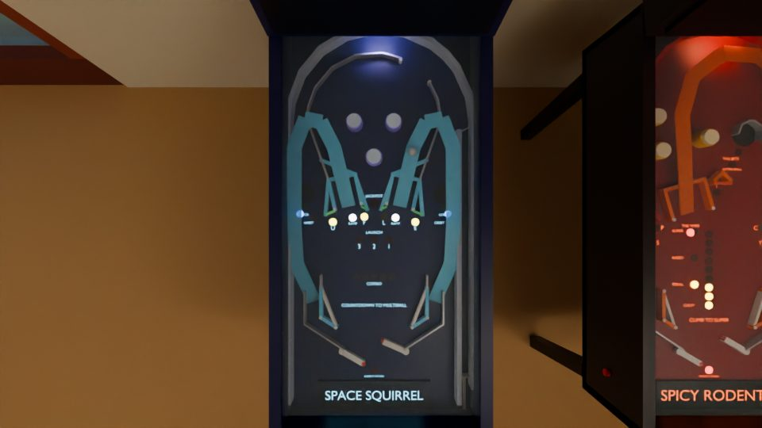
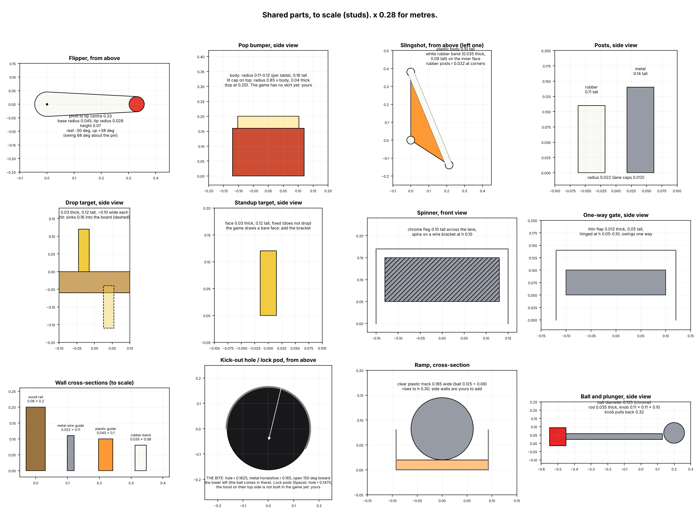

# The three pinball machines, for modelling in Blender

The three machines stand side by side in the bowling alley's games room, 4.5 studs apart, their backs 1 stud off the wall. Facing them, **SPACE SQUIRREL** is on the left, **SPICY RODENT** in the middle and **ACORN ATTACK** on the right. All three use the same cabinet. Each has its own playfield, colours and rules.

Everything here is drawn from the game's own numbers, so you can build to the drawings exactly. The drawings can be redrawn whenever a layout changes (`tools/review/pinball_blender/`).

| File | What it shows |
|---|---|
| `pinball_blender/acorn_plan.png`, `rodent_plan.png`, `space_plan.png` | Each playfield from above, to scale, with every part numbered and a key underneath |
| `pinball_blender/cabinet.png` | The cabinet from the side and the front, with its sizes |
| `pinball_blender/parts.png` | The parts all three share, to scale: flipper, pop bumper, slingshot, posts, targets, spinner, gate, wall sections, hole, ramp, ball and plunger |
| `pinball_blender/blender/*.obj` | A 3D blockout of each playfield and of the cabinet, with every part at its exact place and named, ready to open in Blender and model over |
| `../renders/minigames/pinball/*.jpg` | How the machines look in the game today |

## Size and units

- The game works in studs. The pictures give studs, and metres along the top and right edges.
- Your art packs are modelled in metres and imported with Scale Unit **Meter**, and Roblox counts 1 stud as 0.28 m. So in Blender, multiply each stud figure by 0.28. The blockouts are already in metres.
- **Playfield:** 2.4 × 4.9 studs, which is 0.672 × 1.372 m. That is a real table's 20¼ × 42 inch shape, about 1.3 times real size.
- **Ball:** 0.125 studs across (35 mm).
- **Whole machine:** 7.7 studs tall (2.16 m), 2.7 wide (0.76 m) and about 5.3 deep, including the backbox (1.5 m).
- **Tilt:** the playfield slopes 6.9° down toward the player. In the playfield blockouts the playfield lies flat, so model it flat and the game tilts it. In the cabinet blockout everything stands as it does in the room.
- **Directions in the blockouts:**
  - the origin is the playfield's front-left corner, on its surface;
  - X runs to the player's right;
  - up the table is −Z, and the height above the playfield is Y;
  - Blender's OBJ importer (forward −Z, up Y) turns this into a normal Z-up scene.

## What you can change, and what must stay put

The ball's physics only knows the playfield's flat outline: where each wall, post, bumper, slingshot, flipper, target and lane is.

**These must stay put:**
- Anything the ball touches must keep its position and footprint from the plans. That covers rails, wire guides, posts, bumper bodies, slingshots, flippers, targets, lane dividers and the ramp tracks.
- Keep each part's height about the same, too. Making a guide taller is fine; making it lower than the ball (0.125) is not.

**These are yours:**
- Everything above or around that outline:
  - bumper skirts and caps;
  - the plastics that sit above the ball, between 0.2 and 0.45 high (the glass is at 0.5);
  - ramp side walls and their entrance flaps;
  - the cabinet art, legs, backbox, lockdown bar and coin door;
  - the artwork painted on the playfield;
  - the backglass art.
- Some parts are bare or missing in the game today. They are yours to design, and the plans mark them:
  - the hood over each SPACE SQUIRREL lock pod;
  - ramp side walls;
  - pop bumper skirts;
  - the brackets behind standup targets.

## Parts that move

Each moving part must be **its own object**, with its pivot in the right place:

| Part | How it moves |
|---|---|
| Flippers | Turn about the pivot pin (the black dot on the plans), from 30° below level to 38° above, 68° in all. Put the object's origin on the pin, 0.035 above the board. |
| Drop targets (ACORN ATTACK) | Slide straight down 0.16 into the board when hit, and come back up together |
| Spinner (ACORN ATTACK) | Spins about a level axis across its lane, at 0.10 high |
| Plunger | The rod and knob slide 0.32 toward the player and spring back |
| Pop bumper caps, slingshot rubbers, lamp inserts | Light up or flash (the game recolours them), so each must be a separate object |
| One-way gate | A thin flap that swings one way |
| Balls | Plain spheres, 0.125 across |

## The names the game looks for

The game finds the moving parts by name and number, so keep these names on your objects. The numbers follow the order the game lists them in, shown below. A flipper is a group whose pivot part is called `Hub`. The plunger is a group of `Rod` and `Knob`.

### ACORN ATTACK

| Name in the game | What it is |
|---|---|
| `Flipper1` | left flipper (a group; its pivot `Hub` sits on the pin, 0.035 above the board) |
| `Flipper2` | right flipper (a group; its pivot `Hub` sits on the pin, 0.035 above the board) |
| `BumperCap1` | cap of pop bumper 1 (at x 0.74, y 3.62) |
| `BumperCap2` | cap of pop bumper 2 (at x 1.4, y 3.62) |
| `BumperCap3` | cap of pop bumper 3 (at x 1.07, y 3.16) |
| `Sling1` | left slingshot rubber |
| `Sling2` | right slingshot rubber |
| `Drop1` | drop target A |
| `Drop2` | drop target C |
| `Drop3` | drop target O |
| `Drop4` | drop target R |
| `Drop5` | drop target N |
| `Standup6` | standup target oak_r (does not move) |
| `Standup7` | standup target oak_l (does not move) |
| `Spinner1` | spinner flag |
| `Lamp1` to `Lamp24` | lamp inserts, in this order: `Lamp1` top_1 (amber), `Lamp2` top_2 (amber), `Lamp3` top_3 (amber), `Lamp4` bumper_1 (white), `Lamp5` bumper_2 (white), `Lamp6` bumper_3 (white), `Lamp7` acorn_a (green), `Lamp8` acorn_c (green), `Lamp9` acorn_o (green), `Lamp10` acorn_r (green), `Lamp11` acorn_n (green), `Lamp12` spinner (red), `Lamp13` oak_r (yellow), `Lamp14` oak_l (yellow), `Lamp15` hoard_1 (orange), `Lamp16` hoard_2 (orange), `Lamp17` hoard_3 (orange), `Lamp18` hoard_4 (orange), `Lamp19` hoard_5 (orange), `Lamp20` bonus_2x (white), `Lamp21` bonus_3x (white), `Lamp22` bonus_5x (white), `Lamp23` extra_ball (red), `Lamp24` shoot_again (red) |
| `Ball1` to `Ball3` | the balls (one shows; three in a multiball) |
| `Plunger` | a group: `Rod` and `Knob` |
| `Backglass` | the backbox's face; the score is written on its front |
| `Playfield` | the board |

### SPICY RODENT

| Name in the game | What it is |
|---|---|
| `Flipper1` | left flipper (a group; its pivot `Hub` sits on the pin, 0.035 above the board) |
| `Flipper2` | right flipper (a group; its pivot `Hub` sits on the pin, 0.035 above the board) |
| `BumperCap1` | cap of pop bumper 1 (at x 0.3, y 3.72) |
| `BumperCap2` | cap of pop bumper 2 (at x 0.98, y 3.45) |
| `BumperCap3` | cap of pop bumper 3 (at x 0.36, y 3.28) |
| `Sling1` | left slingshot rubber |
| `Sling2` | right slingshot rubber |
| `Standup1` | standup target spicy_s (does not move) |
| `Standup2` | standup target spicy_p (does not move) |
| `Standup3` | standup target spicy_i (does not move) |
| `Standup4` | standup target spicy_c (does not move) |
| `Standup5` | standup target spicy_y (does not move) |
| `Lamp1` to `Lamp25` | lamp inserts, in this order: `Lamp1` wire (red), `Lamp2` spicy_s (orange), `Lamp3` spicy_p (orange), `Lamp4` spicy_i (orange), `Lamp5` spicy_c (orange), `Lamp6` spicy_y (orange), `Lamp7` hot_lane (red), `Lamp8` bite (red), `Lamp9` extra_ball (red), `Lamp10` bumper_1 (red), `Lamp11` bumper_2 (red), `Lamp12` bumper_3 (red), `Lamp13` heat_1 (yellow), `Lamp14` heat_2 (yellow), `Lamp15` heat_3 (yellow), `Lamp16` heat_4 (orange), `Lamp17` heat_5 (orange), `Lamp18` heat_6 (orange), `Lamp19` heat_7 (red), `Lamp20` heat_8 (red), `Lamp21` heat_9 (red), `Lamp22` feral (yellow), `Lamp23` rabid (orange), `Lamp24` super (red), `Lamp25` shoot_again (red) |
| `Ball1` to `Ball3` | the balls (one shows; three in a multiball) |
| `Plunger` | a group: `Rod` and `Knob` |
| `Backglass` | the backbox's face; the score is written on its front |
| `Playfield` | the board |

### SPACE SQUIRREL

| Name in the game | What it is |
|---|---|
| `Flipper1` | left flipper (a group; its pivot `Hub` sits on the pin, 0.035 above the board) |
| `Flipper2` | right flipper (a group; its pivot `Hub` sits on the pin, 0.035 above the board) |
| `BumperCap1` | cap of pop bumper 1 (at x 0.85, y 3.66) |
| `BumperCap2` | cap of pop bumper 2 (at x 1.365, y 3.66) |
| `BumperCap3` | cap of pop bumper 3 (at x 1.1075, y 3.2) |
| `Sling1` | left slingshot rubber |
| `Sling2` | right slingshot rubber |
| `Standup1` | standup target fuel_f (does not move) |
| `Standup2` | standup target fuel_l (does not move) |
| `Standup3` | standup target fuel_u (does not move) |
| `Standup4` | standup target fuel_e (does not move) |
| `Lamp1` to `Lamp25` | lamp inserts, in this order: `Lamp1` dock (blue), `Lamp2` orbit_l (blue), `Lamp3` orbit_r (blue), `Lamp4` bumper_1 (blue), `Lamp5` bumper_2 (blue), `Lamp6` bumper_3 (blue), `Lamp7` ramp_l (white), `Lamp8` ramp_r (white), `Lamp9` fuel_f (yellow), `Lamp10` fuel_l (yellow), `Lamp11` fuel_u (yellow), `Lamp12` fuel_e (yellow), `Lamp13` pod_1 (green), `Lamp14` pod_2 (green), `Lamp15` extra_ball (red), `Lamp16` count_1 (red), `Lamp17` count_2 (red), `Lamp18` count_3 (red), `Lamp19` combo_1 (white), `Lamp20` combo_2 (white), `Lamp21` combo_3 (white), `Lamp22` combo_4 (white), `Lamp23` combo_5 (white), `Lamp24` jackpot (red), `Lamp25` shoot_again (red) |
| `Ball1` to `Ball3` | the balls (one shows; three in a multiball) |
| `Plunger` | a group: `Rod` and `Knob` |
| `Backglass` | the backbox's face; the score is written on its front |
| `Playfield` | the board |

## The cabinet (all three)

- **Body:** a box 2.7 wide, tilted with the playfield. It is 0.85 deep under the playfield and its side walls stand 0.55 above it.
- **Lockdown bar:** chrome, across the front, just above the glass.
- **Glass:** 0.5 above the playfield.
- **Legs:** four, 0.22 square, set in 0.22 from the sides. The front pair is 2.46 tall and the back pair 3.02, which gives the slope.
- **Front:**
  - a coin door 0.70 × 0.55 that only says FREE PLAY (no coin is ever taken);
  - a red flipper button on each side;
  - the plunger knob on the player's right, in line with the shooter lane.
- **Backbox:** stands on the back. It is 2.7 wide, 3.25 tall (from 4.45 to 7.7 above the floor) and 0.6 deep.
  - Its front is the backglass, where the game writes five lines: title, score, info, a message and the best score.
  - A light strip runs along its top.
  - A soft light shines from its underside down onto the playfield.

## ACORN ATTACK: the gentle old electro-mechanical one

**Look:**
- a walnut cabinet (118, 74, 40) with brass trim (196, 160, 92);
- a tan playfield (206, 172, 112);
- amber plastics, rust-red bumpers and a cream lettering colour;
- an autumn sun over an oak on the backglass.

**Rule in one line:** fill the hoard with acorns before winter.

**Parts:**
- three top lanes under the arch, with four wire guides;
- three pop bumpers;
- the **A-C-O-R-N bank** of five drop targets on the left, set at a slant and facing down the table, with a rubber and a wooden wall behind;
- a **spinner lane** up the right side;
- two **OAK** standup targets with wedge-shaped wooden backs, either side of the low bumper;
- a rebound rubber across the left of the arch;
- curved rail guides that turn a ball into the inlanes;
- the flippers, slingshots, inlanes and outlanes.

**Lamps:**
- THE HOARD: five orange lamps across the middle;
- the bonus 2X, 3X and 5X lamps;
- a green lamp beside each letter;
- EXTRA BALL and SHOOT AGAIN.

**Painted words:** A, C, O, R, N, THE HOARD, 2X / 3X / 5X, SPIN, OAK, EXTRA BALL, SHOOT AGAIN, and across the middle, FILL THE HOARD BEFORE WINTER.

## SPICY RODENT: the fast, hungry one

**Look:**
- a near-black cabinet (30, 22, 26) with red trim (200, 30, 30);
- a deep red playfield (150, 26, 22);
- orange plastics, yellow bumpers and orange lettering;
- a heat glow rising on the backglass.

**Rule in one line:** feed the rodent until it goes SUPER.

**Parts:**
- **THE WIRE**, one long ramp:
  - it starts at a wide mouth middle-left, for the right flipper;
  - it climbs to 0.3 high, curves round the top of the table and comes down the right side;
  - it drops the ball into the right inlane;
  - its height at each bend is marked "h" on the plan.
- **THE BITE:** a kick-out hole top right inside a metal horseshoe that opens toward the lower left; it holds the ball, then kicks it back down the table.
- **The HOT LANE** up the right side: a soft plunge rolls down it for the skill shot.
- **The nest:** three pop bumpers top left.
- The **S-P-I-C-Y** standup targets: S and P on the left, I in the centre (with a pointed back), C and Y on the right.

**Lamps:** a HEAT meter of nine lamps up the middle (yellow, then orange, then red), with CALM, FERAL, RABID and SUPER beside it.

**Painted words:** CLIMB TO SUPER, THE WIRE, THE BITE, HOT LANE, and the letters.

## SPACE SQUIRREL: the flow table

**Look:**
- a deep blue cabinet (26, 30, 80) with silver trim (190, 200, 220);
- a navy playfield (22, 34, 90);
- ice-blue plastics, violet bumpers and green targets;
- a ringed planet on the backglass.

**Rule in one line:** fuel the rocket, lock two balls, LIFTOFF into a three-ball multiball.

**Parts:**
- **Two ramps that feed each other:**
  - the left ramp is shot from the right flipper and drops into the left inlane;
  - the right ramp is the mirror of it.
  - Both rise to 0.3 and run down the outside of the table.
- **The ORBIT:** a lane all the way round under the arch, inside a curved metal guide, with switches at both ends and at the top.
- **The DOCKING GAP:** an opening in the orbit guide, top right, that a soft plunge falls through (the skill shot).
- **Asteroid field:** three pop bumpers inside the orbit.
- **Two LOCK PODS:** holes in the floor of the orbit lanes, beside the ramps. Only a ball going up the table drops in.
  - **Their hood is not built yet: design one.** It should sit on the side toward the top of the table, so a ball coming down rides over it.
- The **F-U-E-L** standup targets at the corners of the two ramp mouths.

**Lamps:** countdown 3, 2, 1, five COMBO lamps, JACKPOT, and lamps for the ramps, the orbit and the locks.

**Painted words:** COUNTDOWN TO MULTIBALL, LAUNCH, COMBO, JACKPOT, ORBIT, RAMP, LOCK, and the letters.

## The shared parts

All three machines share these:
- the flippers (0.33 from pin to tip; 0.09 across at the pin and 0.056 at the tip; 0.07 tall);
- the slingshots;
- the posts (rubber 0.11 tall, metal 0.14, both 0.022 radius);
- the targets (0.03 thick, 0.12 tall);
- the wall sections:
  - wooden rails 0.06 × 0.2;
  - wire guides 0.022 × 0.11;
  - plastic guides 0.045 × 0.1;
  - rubber bands 0.035 × 0.08;
- the shooter lane, the plunger and the gate at the head of the lane.

Pop bumpers are 0.11 to 0.12 in radius depending on the table, 0.16 tall, with a lit cap on top.

## Before it goes into the game

- **Materials:** use plain colours, or one texture per mesh. Layered material sets (SurfaceAppearance) are kept out of the published place at present.
- **Part count:** keep it modest. Each machine is about 140 parts today, with a ceiling of 160. A few well-made meshes can replace many parts.
- **Bring it in:** send the files the way you sent the store and roof packs. I will fit them to the machines, keep the moving parts' names, and check them against the physics.
