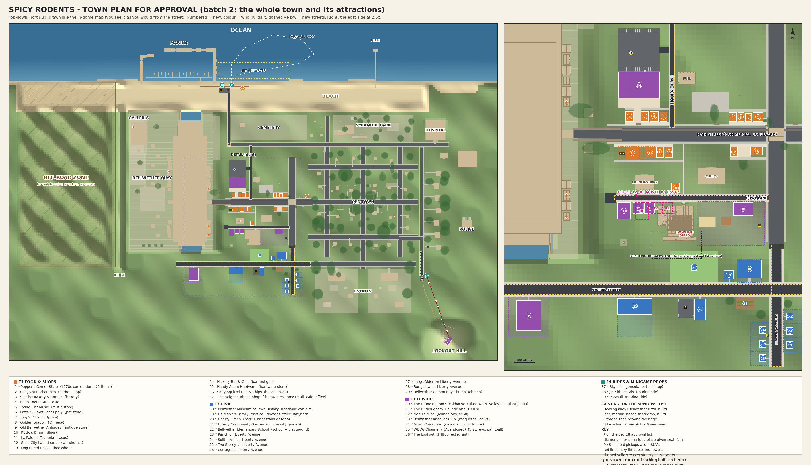

# Batch 2: the whole town and its attractions (build spec for the four family builders)

Planner output, 2026-11-09. Authority: `docs/reference/Roblox_Rebuild_Brief_v2.md` (§3 neighbourhood expansion, §13a places
and attractions, §14 camera, §15 decisions incl. dec 18 and "rides versus minigames"), then `docs/spec/BRIEF_ADDENDUM.md`,
then `docs/spec/BUILD_PLAN.md` (§3.16-§3.18, W3b #7/#13/#14, W3c #15-#20, W4b, invariant 4). The engineering rules of
`docs/HANDOFF.md` §3 are binding (rule 1 cross-root requires via `Import`, rule 9 art lanes, rule 11 no LFS, and the
owner-facing rule: everything interactive says on screen what it is and what to press, and never ignores input silently).

**What already exists from this planning step (do not redo):**

| Artefact | Path | What it is |
|---|---|---|
| Layout data | `data/expansion.json` | One record per venue (46), 7 streets, 19 pads, 20 paths, 4 rides, 3 zones, 10 vehicles, 3 parking moves. STUDS. |
| Schema | `tools/compile/schema/expansion.schema.json` | Enums for families, venue types, anchor kinds, entrance kinds, games, rides. |
| Compiler | `tools/compile/lib/Expansion.luau` (hooked in `tools/compile/main.luau`) | Validates, checks the layout against the town, emits `generated/Expansion.luau` with world points. |
| Tests | `tests/unit/compile_expansion.spec.luau` | Layout sound; the checker catches bad layouts; food census; anchors; rides; frame; approval labels. |
| Approval map | `docs/owner/files/town_map.png` (render: `tools/review/approval_map.luau` + `.py`) | Owner map, north up, drawn like the in-game map; every new venue numbered. |
| Review views | `tools/review/views_batch2.json` | 72 opt-in viewpoints (street + inside per venue, district aerials). |
| Project mapping | `default/ci/build.project.json` | `Workspace.Expansion.F1..F4` from optional `build/Expansion_F1..F4.rbxm`. |

Change a placement only by editing `data/expansion.json` and running `lune run tools/compile/main.luau compile`: the
compiler re-checks every overlap, door, floor and count and refuses to write on any failure. Never hard-code a world
coordinate in a builder; everything is relative to the venue frame (§2.1).

---

## 0. The plan on one screen

- **The town grows east and south** around the existing east commercial district and the bowling alley, plus the beach,
  the marina and the hill. Nothing existing moves (three unbuilt v5.4 parked-car spots are relocated, §1.5).
- **Main Street** (the existing commercial boulevard, z = 0): two rows of 15 shopfronts and restaurants behind paved
  forecourts, service alleys with dumpsters behind, a pocket park round the old elm, a trolley plaza walk-through.
- **Bowl Lane** (new, z = -312): the leisure strip. Steakhouse with outdoor bar, sand volleyball and giant Jenga; the
  existing bowling alley; the antique store; Lounge Row (1940s lounge, sci-fi lounge); the racquet club.
- **Acorn Commons** (new small mall, north of Main Street on Commons Drive) with the glass wind-tunnel tower.
- **The Liberty quarter** (new, Liberty Avenue x = 867.5 and Chapel Street z = -762.5): museum, doctor's office,
  Liberty Green with its bandstand gazebo, the community garden, the school with its playground, the church and the
  6 new homes. This is decision 18's "south-east school and church block".
- **Riverside Works**: the abandoned five-storey WBLW Channel 7 TV station (paintball shell) at the east end of Chapel St.
- **Waterfront**: Marina Road, the marina car park, a beach boardwalk, the seafood shack, jet-ski rental and parasail.
- **Lookout Hill**: the sky lift from Lift Road (the westside street continued) up to the Lookout, a summit restaurant
  with the lift's summit hall built in; a walking trail for those who will not ride.
- **10 driveable trucks**: 6 pickups and 4 SUVs on named spots (§6.10).
- **Food**: 9 v5.4 baseline + 10 new enterable = **19 food businesses**, all 8 kinds (BUILD_PLAN invariant 4).

| Family | Owns | New venues | Part budget |
|---|---|---|---|
| **F1 food_shops** | 16 restaurants and shops, 7 upgrades of existing food places | 16 + 7 | 10,830 |
| **F2 civic** | museum, doctor, green + gazebo, garden, school, church, 6 homes, **all new streets, pads and the shared paths** | 13 | 7,680 + streets ~2,000 |
| **F3 leisure** | steakhouse, both lounges, racquet club (building), mall (shell), TV station, the Lookout | 7 | 11,450 |
| **F4 rides_minigame_props** | sky lift (base station, towers, cable, cabins), jet ski, parasail, wind tunnel, racquetball, volleyball, giant Jenga, tilt labyrinth, bead maze, kite, the 10 trucks | 3 + mechanisms in F2/F3 venues | ~3,300 |

**Hard cap: 36,000 parts for the whole expansion** (the town bake is 27,170, the alley 2,762, the backdrop 3,499).

Order (dependencies, §7): F2 streets and pads first (everyone's doors connect to them); F3 shells before F4 mechanisms
inside them (mall void, racquet court room, steakhouse sand and deck, Lookout lift hall); F2's doctor's table before
F4's labyrinth. F1 depends only on F2's forecourts and alleys.

---

## 1. The layout



The map is drawn like the in-game map (Shared/Map/MapModel): north (+Z) up and **+X on the left**, which is how the
town looks from the street. The data and these docs keep the v5.4 naming (`east_commercial` is +X, the hospital is
"west"), so "east" in this file means +X.

### 1.1 Streets (`streets`, built by F2 with `Builders/Road` on the compiled `strips`)

| id | name | runs | asphalt | sidewalks | meets existing |
|---|---|---|---|---|---|
| `xs_bowl_lane` | BOWL LANE | along x at z -312, x 903.75..1660 | 24 | 6 @ ±15 | cross street (rd_022, rd_024) |
| `xs_liberty_ave` | LIBERTY AVENUE | along z at x 867.5, z -1140..-537.5 | 45 | 8.25 @ ±30.25 | cross street end (rd_022) via `xp_liberty_taper` |
| `xs_chapel_st` | CHAPEL STREET | along x at z -762.5, x 645..2300 | 50 | 8.75 @ ±30.25 | estate avenue end (rd_037/038/039) |
| `xs_lift_road` | LIFT ROAD | along z at x -722.5, z -905..-610 | 37.5 | 6.25 @ ±25 | westside street end (rd_071/072/073) |
| `xs_commons_drive` | COMMONS DRIVE | along z at x 1378, z 32.5..693.75 | 22 | 5 @ ±13.5 | boulevard and north cross road |
| `xs_north_cross_ext` | NORTH CROSS ROAD (EXT.) | along x at z 707.5, x 1627.5..1665 | 27.5 | 5.5 @ ±23.25 | north cross road end (rd_049/050/051) |
| `xs_marina_road` | MARINA ROAD | along z at x 1650, z 693.75..1345 | 30 | 6 @ ±18 | via the extension |

Threaded, on purpose: Bowl Lane's centre is z -312 so its kerb clears the cross-street lamp R13 at z -288; Commons
Drive is 22 + 2 x 5 wide so it passes between the boulevard lamp R25 (1397.7, 36) and the north-cross lamp L29
(1358.7, 690.5). No traffic AI on the new streets this batch (lanes are a later wave); F2 adds lamps with
`WorldGen/LampPlan.plan` on the new strips (one row per street, ~105 st apart, §3.19 rule) and stop signs at the four
new junctions as props.

### 1.2 Pads and paths

Pads (`pads`, axis-aligned rects): four **forecourts** between the boulevard sidewalks and the shopfronts (the v5.4
utility poles 194-218, a streetlight, a hydrant and a bench stand in them and stay; `keeps` names them), four **service
alleys** behind the shop rows (dumpsters live there), `xp_trolley_plaza` (behind trolley stop 2, the walk to the mall),
`xp_pocket_park` ("Elm Corner" round Tree_818), the mall forecourt, car park and entry, the lift, marina and church car
parks, the Liberty taper and the Bowl Lane turning circle. Paths (`paths`, polylines with a width): the beach
boardwalk, the Alley Walk (Main Street to Bowl Lane at x 1322, straight to the bowling alley's steps), the hill trail
and one short walk per door that is more than 16 st from the network. **Owner of each pad and path = its `family`.**

### 1.3 Venue table (all families; positions are the footprint centre, studs)

`floorY` is the finished floor (0.3..1.5 above the highest ground under the footprint; lawns follow the ground).
`ground min..max` tells you how deep the plinth or skirt goes on the low side.

#### F1

| id | name | at (x, z) | facing | footprint w x d | floorY (ground min..max) | storeys / height | part budget |
|---|---|---|---|---|---|---|---|
| `f1_corner_store` | PEPPER'S CORNER STORE | 957, 84 | -Z | 48 x 44 | 14.1 (12.49..13.52) | 1 / 15 | 900 |
| `f1_barber` | CLIP JOINT BARBERSHOP | 1003, 82 | -Z | 32 x 40 | 13.5 (11.64..12.94) | 1 / 14 | 700 |
| `f1_bakery` | SUNRISE BAKERY & DONUTS | 1041, 84 | -Z | 32 x 44 | 12 (9.57..11.4) | 1 / 14 | 500 |
| `f1_cafe` | BEAN THERE CAFE | 1081, 84 | -Z | 36 x 44 | 10 (6.9..9.48) | 1 / 14 | 550 |
| `f1_music` | TREBLE CLEF MUSIC | 1420, 86 | -Z | 36 x 48 | 7.4 (3.66..6.83) | 1 / 14 | 650 |
| `f1_pet_store` | PAWS & CLAWS PET SUPPLY | 1466, 88 | -Z | 44 x 52 | 6.8 (2.49..6.22) | 1 / 14 | 800 |
| `f1_pizza` | TONY'S PIZZERIA | 1512, 87 | -Z | 36 x 50 | 5.3 (1.8..4.76) | 1 / 14 | 550 |
| `f1_chinese` | GOLDEN DRAGON | 1586, 87 | -Z | 40 x 50 | 3.6 (1.56..3.07) | 1 / 14 | 600 |
| `f1_antique` | OLD BELLWETHER ANTIQUES | 1360, -264 | -Z | 40 x 52 | 15.5 (11.58..14.91) | 1 / 14 | 900 |
| `f1_diner` | ROSIE'S DINER | 964, -82 | +Z | 60 x 40 | 11.5 (7.46..10.96) | 1 / 14 | 650 |
| `f1_taco` | LA PALOMA TAQUERIA | 1436, -88 | +Z | 36 x 52 | 10.3 (8.83..9.74) | 1 / 14 | 550 |
| `f1_laundromat` | SUDS CITY LAUNDROMAT | 1075, -86 | +Z | 34 x 48 | 16.8 (12.82..16.23) | 1 / 14 | 600 |
| `f1_bookshop` | DOG-EARED BOOKS | 1394, -88 | +Z | 36 x 52 | 11.6 (9.76..11.08) | 1 / 14 | 650 |
| `f1_grill` | HICKORY BAR & GRILL | 1485, -90 | +Z | 50 x 56 | 9.4 (8.03..8.87) | 1 / 14 | 700 |
| `f1_hardware` | HANDY ACORN HARDWARE | 1572, -92 | +Z | 64 x 60 | 9.7 (7.59..9.15) | 1 / 14 | 800 |
| `f1_seafood` | SALTY SQUIRREL FISH & CHIPS | 1480, 1398 | +Z | 36 x 28 | 3.3 (2.3..2.8) | 1 / 14 | 450 |
| `f1_up_corner_shops` | CORNER SHOPS (upgrade of `east_corner_shops`) | 1512.5, -235 | +Z | existing | 8.35 | - | 40 |
| `f1_up_icecream_strip` | ICE CREAM (STRIP) (upgrade of `outer_icecream_strip`) | -385, -165 | +Z | existing | 3.95 | - | 40 |
| `f1_up_old_anchor` | THE OLD ANCHOR (upgrade of `quay_bldg_w_00`) | 1895, -405 | +X | existing | 20 | - | 40 |
| `f1_up_willow_bakery` | WILLOW BAKERY (upgrade of `quay_bldg_w_02`) | 1895, -300 | +X | existing | 20 | - | 40 |
| `f1_up_copper_kettle` | COPPER KETTLE (upgrade of `quay_bldg_w_04`) | 1895, 157.5 | +X | existing | 20 | - | 40 |
| `f1_up_tea_room` | THE TEA ROOM (upgrade of `quay_bldg_e_08`) | 2385, 375 | -X | existing | 20 | - | 40 |
| `f1_up_copper_cup` | COPPER CUP CAFE (upgrade of `galleria_shop_5_copper_cup_cafe`) | 2820, 925 | -X | existing | 20 | - | 40 |

#### F2

| id | name | at (x, z) | facing | footprint w x d | floorY (ground min..max) | storeys / height | part budget |
|---|---|---|---|---|---|---|---|
| `f2_museum` | BELLWETHER MUSEUM OF TOWN HISTORY | 1000, -661 | -Z | 120 x 90 | 3 (0.25..2.41) | 2 / 34 | 1200 |
| `f2_doctor` | DR. MAPLE'S FAMILY PRACTICE | 1100, -690 | -Z | 48 x 44 | 5.3 (0.91..4.71) | 1 / 15 | 650 |
| `f2_liberty_green` | LIBERTY GREEN | 1270, -679 | -Z | 230 x 90 | 10.34 (5.75..10.34) | lawn | 500 |
| `f2_gazebo` | LIBERTY BANDSTAND (inside the green) | 1270, -655 | -Z | 28 x 28 | 9.9 (8.74..9.35) | 1 / 16 | 250 |
| `f2_community_garden` | LIBERTY COMMUNITY GARDEN | 1020, -830 | +Z | 90 x 50 | 1.59 (0.25..1.59) | lawn | 350 |
| `f2_school` | BELLWETHER ELEMENTARY SCHOOL | 1560, -845 | +Z | 170 x 80 | 20.9 (16.93..20.31) | 2 / 30 | 1500 |
| `f2_home_1` | RANCH ON LIBERTY AVENUE | 801, -895 | +X | 36 x 34 | 4.2 (1.89..3.61) | 1 / 16 | 380 |
| `f2_home_2` | SPLIT LEVEL ON LIBERTY AVENUE | 801, -965 | +X | 36 x 34 | 7.5 (4.68..7) | 2 / 26 | 380 |
| `f2_home_3` | TWO STOREY ON LIBERTY AVENUE | 801, -1035 | +X | 36 x 34 | 11.8 (8.21..11.3) | 2 / 26 | 380 |
| `f2_home_4` | COTTAGE ON LIBERTY AVENUE | 934, -960 | -X | 36 x 34 | 9.1 (5.61..8.52) | 1 / 16 | 380 |
| `f2_home_5` | LARGE OLDER ON LIBERTY AVENUE | 934, -1030 | -X | 36 x 34 | 12.9 (10.47..12.37) | 2 / 26 | 380 |
| `f2_home_6` | BUNGALOW ON LIBERTY AVENUE | 934, -1100 | -X | 36 x 34 | 14 (12.38..13.42) | 1 / 16 | 380 |
| `f2_church` | BELLWETHER COMMUNITY CHURCH | 1240, -860 | +Z | 56 x 104 | 13 (8.68..12.47) | 1 / 30 | 950 |

#### F3

| id | name | at (x, z) | facing | footprint w x d | floorY (ground min..max) | storeys / height | part budget |
|---|---|---|---|---|---|---|---|
| `f3_steakhouse` | THE BRANDING IRON STEAKHOUSE | 1030, -366 | +Z | 96 x 64 (site 309 x 215) | 18.2 (14.07..17.61) | 1 / 20 | 1700 |
| `f3_lounge_classic` | THE GILDED ACORN | 1487, -362 | +Z | 50 x 56 | 9.5 (4.95..8.94) | 1 / 22 | 1300 |
| `f3_lounge_scifi` | NEBULA NINE | 1545, -362 | +Z | 50 x 56 | 5.7 (0.44..5.19) | 1 / 24 | 1300 |
| `f3_racquet_club` | BELLWETHER RACQUET CLUB | 1614, -376 | +Z | 64 x 84 | 2.6 (0.25..2.1) | 1 / 30 | 650 |
| `f3_mall` | ACORN COMMONS | 1540, 241 | -Z | 200 x 130 | 7.7 (0.25..7.16) | 2 / 32 | 2000 |
| `f3_tv_station` | WBLW CHANNEL 7 (ABANDONED) | 2080, -890 | +Z | 120 x 150 | 8.6 (0.25..8.06) | 5 / 72 | 3500 |
| `f3_hilltop` | THE LOOKOUT (+ sky-lift summit hall) | -1050, -1710 | yaw 0.85 (NE, toward town) | 100 x 50 | 116 (108.6..115.41) | 1 / 18 | 1000 |

#### F4

| id | name | at (x, z) | facing | footprint w x d | floorY (ground min..max) | storeys / height | part budget |
|---|---|---|---|---|---|---|---|
| `f4_lift_base` | SKY LIFT (base station) | -776, -905 | yaw 1.899 (local +X runs down the cable) | 50 x 30 | 5.7 (3.57..5.17) | 1 / 18 | 500 (+ towers, cable, 6 cabins: 400) |
| `f4_jetski` | JET SKI RENTALS | 1730, 1444 | +Z (the sea) | 24 x 16 (+ dock to D -100) | 3.4 (1.94..2.87) | 1 / 11 | 350 |
| `f4_parasail` | PARASAIL | 1610, 1444 | +Z | 24 x 16 (+ dock to D -100) | 4.2 (2.44..3.66) | 1 / 11 | 300 |

F4's mechanisms in other families' venues (anchors with `owner: "F4"`): wind tunnel (mall), racquetball (racquet club),
volleyball and beach ball and giant Jenga (steakhouse), tilt labyrinth and bead maze (doctor), kite spot (green), the
sky-lift summit platform (Lookout), the pickup and SUV spots.

### 1.4 What was surveyed

`tools/compile/lib/Expansion.luau` checks every venue site against: the 243 lots (solid ones; area lots like parks and
plazas excluded), the 116 roads (sidewalks included), the new streets, sidewalks and pads, the bowling alley's
footprint, the 95 tree trunks and 12 apple trees (trunk radius + 2 st) and the 1,332 harvested routes (any route point
inside a site below its roof + 3 st). The planner also checked the **baked** town (build/Town.rbxm, every part's XZ box):
the only contacts left are intended ones (tree canopies over sidewalks, overhead wires above Commons Drive, the
forecourts paved round the existing poles, a pickup on a v5.4 driveway).

### 1.5 Moves and leftovers

- `parkingMoves`: three v5.4 static parked placements fall inside new venues and are **not built yet** (W3 parking
  data): the corner-shops car (1465, -82.5) -> Bowl Lane verge (1512, -282); the car at (1395, 355) -> the mall car park
  (1460, 340); the delivery van (1510, 275) -> the mall car park's service corner (1625, 330). Whoever lands parking
  data uses the `to` positions.
- The quay entry sign "BELLWETHER QUAY" at (1625, 62.5) keeps the east end of the north row clear (that is why the
  antique store moved to Bowl Lane).
- Existing park gazebo (north_gazebo) and Tabasco Garden stay as they are; the brief's "park with gazebo, community
  garden" are new and real (collidable, interactive) in the Liberty quarter.
- The two v5.4 gas stations already satisfy "gas station" (checked by the compiler).

---

## 2. Shared contracts (every family)

### 2.1 Data: `generated/Expansion` (Shared.Generated.Expansion; `Data.default():module("Expansion")`)

- `venues[i]`: everything in the JSON plus `place = { x, z, floorY, yaw }`, `sitePoly`, `footPoly` (world XZ
  corners) and, on every entrance and anchor, `world = { x, y, z }`.
- **Frame** (same as the bowling alley): origin at the footprint centre on the finished floor; local **X** across the
  frontage (+X on your right as you walk in), **Y** up, **D** into the building (front face at D = -d/2). The front
  faces world `(sin yaw, 0, cos yaw)`. `Shared/Attractions/AlleyLayout.toWorld(place, X, Y, D)` converts; in Lune bakes
  use `tools/bake/alley/Kit.new(roblox, venue.place)` and draw in local coordinates (require it, do not copy it).
- `footprint {w, d}` is the building; `site {x0, x1, d0, d1}` (local) is everything you may build (yards, patios,
  courts, car parks, docks). Nothing of yours outside your site, pads and paths.
- **Anchors are the contract between families and with the server.** Each has `id`, `kind`, local `at`, local `yaw`
  (degrees), `owner` and extras (`game`, `ride`, `item`, `forage`, `gig`, `reputation`, `serves`, `book`, `note`).
  The `owner` builds the thing at the anchor; the venue's family leaves room for it (a clear 1-stud margin round
  minigame and ride anchors unless the note gives a volume).
- `strips`: Road-shaped records (`id, kind, axis, coord, start, end, width`) for every new carriageway and sidewalk:
  feed them to `Plan.road` + `Builders/Road` and `LampPlan.plan` unchanged.
- To change data: edit `data/expansion.json`, run `lune run tools/compile/main.luau compile`, run
  `lune run tests/run.luau compile_expansion`, re-render the map (§8).

### 2.2 Bakes

- One bake per family: `tools/bake/expansion_f1.luau` ... `expansion_f4.luau` -> `build/Expansion_F<N>.rbxm`, a root
  `Folder` (any name) that Rojo maps to **`Workspace.Expansion.F<N>`** (already in all three project files; a missing
  file is fine). Helpers live in `tools/bake/expansion/f<N>/`. Never write into another family's folder or rbxm.
- Inside: one `Model` per venue named exactly the venue id, attributes `VenueId`, `Family`, `Type`, `FloorY`, `Yaw`,
  `PartBudget`; `ModelStreamingMode = Atomic`. Children by convention: `Shell`, `Interior`, `Props`, `Doors`
  (server-swung like the alley's), `Anchors`, optional `TerrainCarve` (boxes the server fills with Air at boot, the
  AttractionService pattern) and optional `Skyline`.
- **`Anchors` folder:** one anchored, non-colliding, non-queryable, fully transparent 0.2-stud Part per anchor whose
  `owner` is your family, named the anchor id, at its world point with its yaw. This is how the server and the tests
  find things. (Other families' anchors in your venue: leave them to their owner.)
- **Landmarks seen from far** (the drone, the hill): the steeple, the TV mast and roofline, the wind-tunnel tower, the
  Lookout and the sky-lift towers and cable go in a separate `<venue id>_Skyline` Model of <= 40 parts with
  `ModelStreamingMode = Persistent`. Everything else streams.
- **Plinth rule:** the floor top sits exactly at `floorY`; a foundation or skirt (brick, stone or concrete to match)
  runs from the floor down to `ground.min - 2` round the whole footprint, and every entrance gets steps or a ramp from
  `floorY` down to the ground at its path. No floating floors, no buried doors, no terrain poking through a floor
  (if the high side of the ground is within 0.3 of the floor, add a `TerrainCarve` box under the building).
- Every part anchored (runtime physics props are spawned by the server); no part longer than 2048 st; CanQuery off on
  decoration; CastShadow off on small clutter. Bakes print `venue id: N parts` and the family total.
- Part budgets: `partBudget` per venue in the data; a bake that exceeds a venue's budget by more than 10% fails its
  unit test. Family totals: F1 10,830, F2 7,680 + ~2,000 streets/lamps, F3 11,450, F4 ~3,300. **Cap 36,000.**

### 2.3 Server

- One dispatcher, `src/server/Expansion/ExpansionService.luau`, started from `Server/Boot/Game.luau` right after the
  bowling alley (`AttractionService.start`). It is a **one-time integration change owned by F2** (first to land); the
  other families only add `src/server/Expansion/F<N>/init.luau`. Template:

```luau
--!strict
-- ServerScriptService.Server.Expansion.ExpansionService: boots the four batch-2 families (docs/waves/BATCH2_SPEC.md
-- §2.3). Each family module exports start(ctx) -> { step: ((dt: number) -> ())?, stop: () -> () }? and is optional;
-- a missing Workspace.Expansion.F<N> is reported, never fatal.
local ExpansionService = {}
function ExpansionService.start(ctx: any): { step: (number) -> (), stop: () -> () }
	local handles = {}
	local root = workspace:FindFirstChild("Expansion")
	for _, fam in { "F1", "F2", "F3", "F4" } do
		local mod = script.Parent:FindFirstChild(fam)
		local folder = root and root:FindFirstChild(fam)
		if mod == nil then
			continue
		end
		if folder == nil or #folder:GetChildren() == 0 then
			warn(`[Expansion] Workspace.Expansion.{fam} is empty (run lune run tools/bake/expansion_{string.lower(fam)}.luau)`)
		end
		local ok, h = pcall(function()
			return (require :: any)(mod).start({ folder = folder, net = ctx.net, wallet = ctx.wallet, notify = ctx.notify,
				minigames = ctx.minigames, bodyOf = ctx.bodyOf, roles = ctx.roles })
		end)
		if ok and h then
			table.insert(handles, h)
		elseif not ok then
			warn(`[Expansion] {fam} failed to start: {h}`)
		end
	end
	return {
		step = function(dt: number)
			for _, h in handles do
				if h.step then h.step(dt) end
			end
		end,
		stop = function()
			for _, h in handles do h.stop() end
		end,
	}
end
return ExpansionService
```

- Boot progress line for the owner: `[SpicyRodents] 97% Opening the shops, the school and the rides`.
- **No new remotes by default.** Server `ProximityPrompt.Triggered` + the existing `Notify` remote cover purchases,
  seats and refusals; reading UIs (books, exhibits, curios, placards) open on the client from
  `ProximityPromptService.PromptTriggered` with the text in `generated/Expansion` or a family content module; minigames
  ride `Minigame.Input` / `Minigame.State` through `MinigameService` (extend its station list with the Expansion
  anchors of kind `minigame`). A remote that is truly needed goes into `Shared/Net/Schemas` under `Venue.*` or
  `Ride.*`, with a schema test, in one commit.
- Money is integer Spicy cents through `Shared/Economy/Wallet` and `EconomyRules.PRICES` / `Items/ItemRules` prices
  (existing: coffee 12, nachos 5, hot cocoa 10, green tea 8, snow cone 6, jet-ski rental 50, paintball pass 20, garb
  set 100, wind-tunnel balls 15). Server-side only. Nothing random is ever sold (no gambling, ever).
- **New prices (proposed defaults, cheap like the brief's):** haircut 3, donut 4, pizza slice 4, dumplings 5, taco 4,
  diner pie 5, burger 6, fish and chips 6, steak dinner 15, hilltop lunch 10, soda from a vending machine 4, wash or
  dry cycle 2, parasail 30, wind-tunnel flight 25, sky lift free. **F1 adds the whole list to `EconomyRules.PRICES` in
  its first commit** (one edit to the shared file); the other families read them from there.
- People only where the brief says so: animals get no human prompts (hide them on animal clients); a squirrel that
  walks into a squirrel-proof place is stopped with a line (§5).

### 2.4 The owner-facing rule, made concrete

- Every interactive anchor gets a ProximityPrompt: `ObjectText` = the thing ("Barber chair", "Bird seed"),
  `ActionText` = verb + price ("Get a haircut", "Buy - 40c"), key E, `MaxActivationDistance` 8, `RequiresLineOfSight`
  true. Hold 0.5 s for anything 40 cents or more.
- Every refusal says why through `Notify`: "You need 12c; you have 7c", "Members only: a Paintball pass (20c, 5
  in-game days) gets you in - buy it here?", "Closed: back at 8:00", "Only people can use this". Never a dead prompt,
  never a silent no-op.
- Every venue has a readable sign (SurfaceGui text, `Kit:gui` / `Kit:label`) with its name on the street side, lit at
  night; shops show OPEN / CLOSED; staffed counters show "Back soon" when no worker is posted (BUILD_PLAN W3b #7).

### 2.5 Art bar (all families)

- **Procedural only** (brief v2 §15 dec 23): parts, colours, materials and SurfaceGui text from the bakes; Blender
  only for a hero prop worth a real mesh (FBX axis_forward=Z, axis_up=Y, FBX_SCALE_ALL; Open Cloud
  `node tools/cloud/cloud.mjs upload_asset --type Model`, display name <= 50 chars; Blender at
  /root/.cache/spicy-rodents/venv, max 2 threads). Do not touch `tools/blender/trees/**`, `tools/blender/heroes/**`,
  `data/art/trees.json`, `data/art/heroes.json` (other agents).
- **Distinct facades:** no two neighbouring shops share wall colour, trim, awning and sign style; storefront glass,
  door with frame and handle, awning or canopy, a lit sign, a planter or bench; back walls get a service door, a meter
  box, the dumpster in the alley.
- **First-person bar** inside anything enterable (brief v2 §14: humans can go first person anywhere): ceiling, light
  fittings that actually light (PointLight / SurfaceLight), skirting, no see-through seams, no floating props within
  2 st of any seat, counter, lane or court, door frames you can see from inside, nothing at head height in walkways
  below 7.5 st.
- **Polish where people pay or play** (dec 23): both lounges, the TV station arena, every minigame. These get extra
  lighting detail (warm pools, rim lights, practical lamps) and material care.
- **Night:** every shopfront has an emissive window band or interior light so Main Street glows (the drone and the
  outbreak cinematic depend on it, §15 street lighting).
- Colours from `src/worldgen/Palette.luau` where they exist; signs in the town's typefaces (Kit labels).

### 2.6 Audio

No uploads (owner-gated, B3). Ship silent, with each `radio` / `music` / `ambient_loop` anchor wired to
`Client/Audio.play(name, pos)` by name only. Only sound IDs already in the repo may be referenced. The owner picks
library tracks (1920s-feel jazz for the Gilded Acorn, pads for Nebula Nine, the diner jukebox) later in Studio; list
the wanted moods in the family's handoff note.

### 2.7 Squirrels, foraging and routes

- Every `dumpster`, `garden_bed`, `bird_feeder` and `compost` anchor is a forage source (`forage` field) with a risk:
  restaurant dumpsters yield 1-3 per in-game day with a homeowner/staff risk of 0.15 (BUILD_PLAN §3.3 example).
- Roof edges, awnings and downspouts of every new building get rail routes (ids in 9100-9999, the attraction-route
  range: register them the way `data/attractions.json` does, local points converted by the compiler) where a squirrel
  could plausibly climb; at least one route per F1 shop row (awning run) and per F2/F3 building.

### 2.8 Review renders (how a reviewer will look)

- One-time (F2, first commit): extend `tools/review/attractions_export.luau` to also read
  `build/Expansion_F1..F4.rbxm` into the same `attractions` group (lights, sign text, terrain carves come for free).
- Render: `lune run tools/review/export.luau --out build/review/scene.json` then
  `/root/.cache/spicy-rodents/venv/bin/python -I tools/review/render.py --scene build/review/scene.json --views tools/review/views_batch2.json --set batch2 --out build/review/batch2 --threads 2 [--only b2_f1_diner_front,b2_f1_diner_inside]`.
- `views_batch2.json` has `b2_<venue id>_front` (eye 5.5 st, from the street) for every new venue,
  `b2_<venue id>_inside` (floor + 5.2) for every enterable one, and the aerials `b2_air_main_street`,
  `b2_air_bowl_lane`, `b2_air_liberty`, `b2_air_tv_station`, `b2_air_waterfront`, `b2_air_hill`, `b2_lookout_view`.
  Add close-ups for your minigames (optIn `batch2`) next to the venue's views. **Look at every render with the Read
  tool before calling a venue done.**

### 2.9 Tests every family adds

1. **Unit** `tests/unit/expansion_f<N>.spec.luau` (Lune; bakes the family in-process or loads its rbxm):
   every venue Model exists with its attributes; every anchor owned by the family exists in `Anchors` within 0.5 st of
   `world`; part count <= budget + 10%; the floor top within 0.1 of `floorY` and the skirt's bottom <= `ground.min`;
   every entrance has an opening >= 4 st wide and >= 7 st clear above `floorY` (box test against the venue's parts);
   no part outside the venue's site polygon (pads/paths excepted); no part inside another venue's site; all anchored;
   sizes <= 2048; the family's content checks below.
2. **Engine smoke** `tools/cloud/tasks/expansion_f<N>_smoke.luau` -> `tests/engine/ExpansionF<N>.luau` on the CI place
   (bake, `rojo build ci.project.json -o build/test.rbxl`, `node tools/cloud/cloud.mjs save_place build/test.rbxl --place ci`,
   `run_engine_tests ... --version <v> --place ci`; 5 creates/min shared; no physics, no players: use PlayerLike stubs as
   `tests/engine/Minigames.luau` does): `Workspace.Expansion.F<N>` present; every interactive anchor has a prompt with
   non-empty `ObjectText` and `ActionText`; each purchase moves the stub's wallet by exactly the price and a broke stub
   gets a refusal message; the family's flows below.
3. **Stay green:** `tools/ci.sh` (stylua, selene, Lune tests, compile check, rojo builds, place tests) and the
   existing smokes `playtest_smoke`, `play_smoke`, `minigame_smoke`.

---

## 3. F1 food_shops (16 new venues + 7 upgrades)

The brief: "Restaurants: roughly double the current count. Mix of diner, pizza, taco, Chinese, café, bakery, ice
cream, bar and grill, each with outdoor seating or a back-alley dumpster (foraging value)." / "Barber shop, music
store, hardware store, laundromat, bookshop, pet store, gas station, corner grocery" / "Detailed stores: antique store,
pet store, a very specific barber shop" / "Sitting at a cafe raises reputation" / "goods are cheap (coffee 12 cents,
nachos 5 cents)" / gigs "restaurant delivery by bike or cart".

**Common to every F1 shop:** a `Storefront` builder (shell, plinth, glazing, door, awning, sign, interior shell with
ceiling and lights, counter) parameterised per venue so 16 shops cost one builder; a staffed `counter` with a
`staff_post` (shared rota of shop workers, BUILD_PLAN W3b #7; "Back soon" without a worker; player can take the cashier
job); restaurants sell at least one item at the counter (prompt "Buy coffee - 12c") that the player holds and
eats/drinks (a short emote, then it is gone); every restaurant has its `dumpster` anchor in the service alley
(forage) and the tables listed as `seat` anchors (sit prompt; café seats raise reputation, `reputation = true`).

| # | Venue | Must have (interactive, from the anchors) |
|---|---|---|
| 1 | **Pepper's Corner Store** (corner grocery, brief §13a) | "a 1970s-style layout (not literally period), a working checkout counter, and about 22 pick-up-able shelf items, every one functional, all cheap except bird seed and the kite". 22 `item_shelf` anchors = the 22 items of `Items/ItemRules.CATALOG`, one item per shelf (the mapping is F1's, except bird seed and the kite, the two dear ones, go on the shelves nearest the checkout, shelf_16-18). Pick up from the shelf (prompt shows name and price), pay at the `checkout` (till pings, receipt Notify), item lands in the profile inventory. Effects per the brief, each must do something visible: water gun squirts (NPCs react; first hit on the rodent stuns 1.3 s once per player), frisbee/football throw and can be caught, bubbles VFX, chalk writes up to 20 letters on pavement (filtered text), flashlight lights at night, umbrella held, peanuts and bird seed bait AI squirrels and birds, dog treats calm a dog, newspaper readable then throwable, camera takes a screenshot (CaptureService), duct tape, whoopee cushion on a seat, harmonica, air horn startles NPCs and squirrels in 12 st, soda and ice cream bar, lawn chair placeable seat, radio plays the library playlist, bike horn, kite (F4 flies it). Side door onto the cross street; bell on the door; linoleum, three low gondolas, wall cooler, pegboard, candy rack. |
| 2 | **Clip Joint Barbershop** ("a very specific barber shop"; Q14 default until the owner says more) | Two `barber_chair`s (hydraulic, red leather, chrome; sit -> "Get a haircut - 3c": a 10 s cut with clippers sound-free animation and a hair-style change or a new hat from the wardrobe list; the player can also take the barber job: `barber_cut`, 3 credits per 20 s), a spinning striped `barber_pole` outside (animated, lit at night), mirror wall with combs in blue Barbicide jars, waiting `bench` with magazines, the `radio` (talk station, silent until the owner picks audio), black-and-white checker floor, framed photos, "NEXT!" bell. |
| 3 | Sunrise Bakery & Donuts (bakery) | Glass display cases with donuts and loaves, counter sale (donut 4c), 2 sidewalk tables, dumpster. |
| 4 | Bean There Cafe (café) | Espresso bar, counter sale (coffee 12c), 6 seats incl. 3 sidewalk tables, all `reputation = true` (sitting raises reputation per in-game hour, BUILD_PLAN §3.15), armchairs, dumpster. |
| 5 | Treble Clef Music (music store) | Guitar wall, a playable `piano` (keys play notes; silent-safe fallback: visual key press + note name until audio), drum kit, record bins, `listening_booth` seat with headphones, register. |
| 6 | **Paws & Claws Pet Supply** (pet store; brief "detailed stores") | `puppy_pen` and `cat_tree` are the pets' home (BUILD_PLAN W3c #20: a few dogs and cats as `Pet` bodies, AI only); fish-tank wall with moving fish, bird cages, dog-treats shelf (item `dog_treats`, 4c), register. Pets react to a player nearby (wag, follow the glass). |
| 7 | Tony's Pizzeria (pizza) | Brick oven with glow, red check tables, counter sale (slice 4c), `delivery` gig post (`gig_delivery`, bike or cart), 2 sidewalk tables, dumpster. |
| 8 | Golden Dragon (Chinese) | Round tables with lazy Susans (spin prompt), fish tank, red lanterns lit at night, counter sale, delivery gig post, dumpster. |
| 9 | **Old Bellwether Antiques** (antique store; "detailed stores") | On Bowl Lane. 12 `curio` anchors: each a distinct procedural object (gramophone, grandfather clock with moving pendulum, ship in a bottle, brass diving helmet, typewriter, rocking horse, globe, cuckoo clock, tin toys, gilded mirror, stuffed squirrel in a bell jar, sea chest) with a one-line description on inspect (Q14 default "browsable curios with one-line descriptions"); dusty warm lighting; register. |
| 10 | Rosie's Diner (diner) | Chrome diner-car facade, long counter with 8 stools, 4 booths, `jukebox` (radio anchor), pie case, counter sale, dumpster. |
| 11 | La Paloma Taqueria (taco) | Papel picado string lights (lit), salsa bar, counter sale (nachos 5c), 2 patio tables, dumpster. |
| 12 | Suds City Laundromat (laundromat) | 5 washers and 3 dryers that run when used (door shuts, drum spins, 30 s timer above each), folding table, vending machine (soda 4c), bench. A great squirrel hiding spot (behind the dryers). |
| 13 | Dog-Eared Books (bookshop) | Tall shelves with a rolling ladder, `readable_shelf` (pull a book: a page of text, at least 10 short public-domain-style procedurally written pages), reading chair (reputation seat), bargain cart, register. |
| 14 | Hickory Bar & Grill (bar and grill) | Bar counter, open grill with glow, side patio with 4 tables and string lights, counter sale, dumpster. |
| 15 | Handy Acorn Hardware (hardware) | Tool aisles, paint mixer wall, key cutter, mower display, lumber yard (`lumber_yard`) where 2 pickups park. Sells the mischief supplies if the plan wants them there (default: corner store, BUILD_PLAN item 44). |
| 16 | Salty Squirrel Fish & Chips (beach shack) | Walk-up service window onto the boardwalk, deck with 4 picnic tables, bins (forage), gull props. |
| a-g | Upgrades (7) | No new shell. Place the anchored tables / benches / bins in front of (or behind) the existing building and make them work: `f1_up_corner_shops` dumpster + 2 benches, `f1_up_icecream_strip` 3 tables under its umbrellas, the four Quay food facades 2 tables each (Copper Kettle and Tea Room seats raise reputation) and the Old Anchor's bin, Copper Cup Cafe 3 reputation seats. 40 parts each. |

**F1 art bar:** Main Street must read as one lively high street at eye level: continuous shopfront rhythm, varied
heights (some false fronts / parapets), awnings in different stripes, warm lit windows at night, sandwich boards and
planters in the forecourts, menus in the windows. Back alleys read as back alleys (bins, crates, grease drum, a
fire-escape ladder that is a squirrel route).

**F1 acceptance (a skeptical reviewer):**

- Renders `b2_air_main_street`, every `b2_f1_*_front` and `_inside`: no two neighbours look alike; every sign legible;
  no hovering or buried base (skirt visible on the low side, steps at every door); poles stand in the forecourt, never
  through an awning; nothing blocks the trolley stop or the pocket park bench; inside views show a ceiling, light,
  counter and props at first-person scale.
- Unit: 22 shelves at the 22 `item_shelf` anchors, each with a price tag reading `ItemRules` price; every restaurant
  has a dumpster in an alley pad and its seats; 16 venue models; budgets.
- Engine smoke: a stub with 100c buys each of the 22 items at the checkout and its wallet drops by the exact sum
  (40 + 60 for seed and kite included); a stub with 3c is refused with a message naming the price; the water gun's
  first hit on a rodent stub stuns it 1.3 s and the second does not; a café seat raises the stub's reputation; the
  barber chair runs a cut and changes the stub's look; a washer runs and stops; a curio prompt opens its line.

---

## 4. F2 civic (13 venues, every new street, pad and shared path)

The brief: "school with playground, church, park with gazebo, community garden" (§3), "Doctor's office: receptionist at
the counter; on the waiting-room table two openable picture books (animals; early America), a wire bead maze, and a
playable tilt marble labyrinth" (§13a; the labyrinth is F4's), "Museum with readable exhibits" (§13a), "accept the 34 + 6
homes with a south-east school and church block" (§15 dec 18), "Residential variety: at least eight distinct house
models ... every individual house gets its own flair ... Backyards with gardens, bird feeders, sheds, fences, dog
houses" (§3), "40 houses have full interiors" (§8).

| # | Venue | Must have |
|---|---|---|
| 17 | **Bellwether Museum of Town History** | Neoclassical portico with columns and grand steps (`xpath_museum_steps`) up from Chapel Street, two-storey hall. **12 `exhibit` anchors + the `centrepiece`** (the 1902 Galleria model). Each exhibit: an object or diorama built from parts plus a placard; pressing E opens a readable card (title, 3-5 sentences, a vector illustration made from UI frames). Content in `src/shared/Expansion/Exhibits.luau` (F2 creates it): town history in the game's own fiction (the founding, the stone bridge, the Galleria, the trolley, the great squirrel winter, the cemetery's oldest stone, the radio tower, the river, the marina, the old TV station, Sycamore Park's oak, the Spicy Rodent legend). Mild rating. Front desk with staff post. |
| 18 | **Dr. Maple's Family Practice** (doctor's office) | `reception` counter with the `receptionist` (AI body posted; greeting line on approach), waiting room with 4 chairs and the **waiting table**: two **openable picture books** (`book_animals`, `book_early_america`: E opens a page-turning book UI, at least 8 spreads each, text-forward with simple vector pictures; Q-default from BUILD_PLAN item 44), and the anchors for F4's bead maze and tilt labyrinth (leave the table top clear at those spots). Exam room with bed, scale, eye chart. |
| 19 | **Liberty Green** + **Liberty Bandstand** (park with gazebo) | Lawn with curving paths, flower beds, lamps, 4 benches (sit), the **notice board** (the NPC mini-missions billboard: "Walk Mrs. Harrison's dog", "Return a lost pet"; shows the open missions, BUILD_PLAN W4b #5). The bandstand is real: collidable octagonal deck 1.2 st up with steps, 8 posts, cone roof with a squirrel roof route, 3 bench seats, string lights at night (the v5.4 park gazebo has no collision; this one must). |
| 20 | **Liberty Community Garden** | 10 raised beds as `garden_bed` forage sources (vegetables that visibly grow and get picked bare, refill weekly), tool shed, compost bins (forage), water butt, scarecrow, low picket fence with a gate onto Chapel Street, between the two big shade trees. |
| 21 | **Bellwether Elementary School** (school with playground) | Two-storey brick school with a bell (`bell`, rings at the in-game school hours), flagpole, front steps; inside: entrance hall, 2 classrooms (desks, blackboard you can write on with chalk), the hall/gym. **Playground** behind, fenced, stepped down the slope: swings (sit and swing), slide (slide down), climbing frame (climb), seesaw (two seats), roundabout (push to spin), hopscotch grid, basketball hoop with a ball. Each toy has its prompt and a working motion. |
| 22-27 | **6 new homes** on Liberty Avenue | Archetypes ranch, split-level, two-storey, cottage, large older house, bungalow (the brief's list minus apartment block and Victorian, which exist), each with distinct flair (palette, trim, roof, porch, door colour), porch light, front walk (`xpath_home_<n>_walk`) and driveway, backyard with `garden` and `feeder` (forage), shed and fence. **Each gets an interior** from `data/interiors` (the FRB templates: bungalow, cottage, victorian, brick) adapted, with door, hide spots and back exit, and is **claimable** (counts toward the 40). `f2_home_4` hosts pickup 6 on its driveway. |
| 28 | **Bellwether Community Church** | Nave with steeple (~84 st, bell; `bell_rope` E rings it), stained-glass windows (coloured translucent panes, lit from inside at night), 8 pews (sit), organ (play: visual keys, silent-safe), pulpit, lawn, car park east (`xp_church_lot`, SUV 1). Faces Liberty Green. |
| - | **Streets, pads, paths** (all `family: F2` ones) | Build every `strips` record with `Plan.road` + `Builders/Road` (kerbs, paint, crossings like the town's), lamps with `LampPlan.plan`, stop-sign props at the new junctions, the four forecourts (paved, with the v5.4 poles and details standing in them untouched), the four service alleys, the trolley plaza (benches, planters), Elm Corner pocket park (tree grate round Tree_818, the existing bench kept), the car parks with bay lines, the Liberty taper, the Bowl Lane turning circle, the Alley Walk and the alley steps path, the hill trail (gravel path following the terrain with switchbacks and a few handrails), all door walks. |

**F2 art bar:** the Liberty quarter must read as a civic heart: the museum's portico and the church spire are the two
landmarks from the green; the school in warm brick with white trim; homes varied and lived-in (bikes, hoses, mailboxes
with family names). Streets match the town's existing road look exactly (same builder).

**F2 acceptance:**

- Renders `b2_air_liberty`, `b2_f2_*_front` / `_inside`: steps and plinths on the low side of the school (relief 3.4)
  and church (3.8); every door has a walk to a sidewalk; the bandstand is solid and roofed; the garden beds read from
  above; the six homes are six different houses.
- Unit: every `strips` record baked as a road model with kerbs; lamps every ~105 st per street (LampPlan report); the
  exhibit content module has >= 13 entries and every `exhibit` anchor maps to one; both picture books have >= 8 spreads;
  6 homes with interiors that pass `Interior`'s nav checks (door to every hide spot and the back exit).
- Engine smoke: each exhibit prompt opens its text for a stub; the two books open and page; the bell rings (attribute
  flips); a playground swing seats a stub and moves; the six homes appear as claimable in the homes service; a stub
  can walk (by the nav graph) from the Liberty Avenue sidewalk to each home's door.

---

## 5. F3 leisure (7 venues)

The brief (§13a), verbatim where it matters:

- "**Elaborate steakhouse**: outdoor bar, glass walls squirrels can see through but not enter (a human refuge), sand
  with a beach ball and a working volleyball net, a playable four-foot giant Jenga on a deck table." Gig: "serving
  tables at the steakhouse".
- "**Lounge one**: squirrel-proof, very tough NPC guards who annihilate any squirrel that tries. Elaborate Blender
  interior, leather and woodwork, fancy counters, a classy 1940s-style bartender serving hot cocoa, coffee, green tea
  and snow cones. Stock licensed jazz from Roblox's music library, 1920s feel."
- "**Lounge two**: the opposite direction, futuristic and surreal, sci-fi and space, lava lamps, dense plants, a
  seamless procedurally generated ambient loop."
- "**New small shopping mall** with the showpiece: an indoor skydiving wind tunnel." (the tunnel is F4's)
- "**Paintball arena inside a big abandoned five-storey TV station** ... 20 spicy cents buys five in-game days of
  access, which also unlocks five days in the lounges ... a five-floor layout with stairwells and a central atrium for
  verticality ... Once inside, players can buy upgraded paintball garb at one Spicy Dollar per set".
- "**A sky lift up a slight hill to a hilltop restaurant** (second vantage over the town)."
- "**Racquetball court**, playable against NPCs or players, with real ball physics." (the game is F4's)
- §14: "Paintball and both lounge interiors are locked to first person."

| # | Venue | Must have |
|---|---|---|
| 29 | **The Branding Iron Steakhouse** | Glass-walled dining room (every pane in the `SquirrelBlocked` set: a squirrel body is stopped at the glass by the server and told "The glass stops you"; humans see through; this is a refuge from the rodent), doors that let people in and not squirrels, 10 tables (sit), host stand, kitchen with a back door and the `kitchen_dumpster` (forage), the `serve_post` for the serving gig (pick up a plate at the pass, carry it to the table whose order light is on; quality = speed; tip for extra-good, BUILD_PLAN §3.9 rule). **Outdoor bar** (`outdoor_bar`, 8 stools, sells drinks), the **sand pit** (80 x 50, raked sand material, the beach ball loose on it) with room for F4's net, the raised **deck** (50 x 40) with F4's giant Jenga table, string lights, the car park (pickup 5). |
| 30 | **The Gilded Acorn** (lounge one) | Art-deco brick front with a neon script sign and an awning; **two tough guards** at the door (`guard_1`, `guard_2`): a squirrel that crosses the door line is killed by them (big readable telegraph, then the kill; Q6 default for a player squirrel: it respawns per the rules of a death by a human), humans pass; the **pass check** (`pass_check`): without the Paintball pass the host says so and offers it for 20c (5 in-game days, lounges included); inside: leather booths, wood panelling, brass and a fancy curved bar; the **1940s bartender** serves hot cocoa 10c, coffee 12c, green tea 8c, snow cone 6c (hold, drink); `music` anchor for the jazz (silent until the owner picks the track); **camera locked to first person inside** (a trigger volume the client camera reads). Lighting polish: warm low pools, bar back-lighting, table lamps. |
| 31 | **Nebula Nine** (lounge two) | Sci-fi and space: a domed or saucer front with porthole windows, a curved chrome bar with glowing edges, 4 **lava lamps** (animated blobs), dense plant walls, star-field ceiling, seating pods; same pass check and one guard; bartender serves the same menu with space names; `ambient_loop` anchor (B3: library pads layered in-engine first; silent until then); first-person lock inside; polish lighting (neon, colour cycling slow). |
| 32 | **Bellwether Racquet Club** (building for racquetball) | Lobby with front desk and lockers, a **regulation court** room 24 x 48 x 24 st exactly where the `court` anchor says (X -12..12, D -6..42 from the venue origin), white walls with red lines, a **glass back wall** and a viewing gallery with a bench; F4 brings the ball, rules, NPC opponent and scoreboard. Court walls and floor are clean collision for F4's physics. |
| 33 | **Acorn Commons** (new small mall) | Two levels, 4 shops (`shop_1..4` rooms with fronts and signs; dressing only this batch), a food kiosk (sells snacks), an escalator or stairs, the forecourt reached from the trolley plaza, the car park behind (SUV 2). **Leave a 24 x 24 void through both floors and the roof at `wind_tunnel`** (local 0, -38) for F4's glass cylinder: the tower is the mall's landmark, visible from Main Street. |
| 34 | **WBLW Channel 7 (abandoned)** | The arena shell to `Server/Paintball/Layout`: **5 floors x 14 st, 120 x 120, central 30 x 30 atrium through floors 1-4, four pillars per floor at ±35, a stairwell per storey in rotating corners** (`arena_origin` at local (0, 0, 15) is the Layout's origin), real walls, floors and stairs matching the Layout's boxes so the projectile sim and the bots agree with what you see; abandoned look: boarded and broken windows, peeling paint (colour variation), dead studio lights, cables, a tilted satellite dish, the rooftop broadcast **mast** (Skyline model, dead red lamps), chain-link fence round a cracked lot. Lobby annex (D -75..-45) with the **pass desk** (20c pass) and the **garb shop** (1 S$ a set; F3 provides the counter, the shop UI is the paintball W4b item). Squirrels excluded (server stop with a line). Polish lighting in the arena (dec 23). |
| 35 | **The Lookout** (hilltop restaurant + lift summit hall) | On the hill crown facing the town; glass front, **terrace** (D -47..-25) with 4 tables and a free **telescope** (E: zooms the camera toward the town; this is the "second vantage"), dining room with 4 tables and a counter; the **lift hall** at the north-west end (X -50..-20, open at the front-left where the cable leaves) holds F4's summit platform and bullwheel at `alight` / `cable_in`; the hill trail arrives at the terrace steps. Floor 116; skirt down the slope on the north-east side (relief 6.8). |

**F3 art bar:** the steakhouse and both lounges are where people pay: they get the best materials and lighting of the
batch. The TV station must look abandoned, not unfinished. The Lookout must look good from town (silhouette on the
crown) and from the terrace (the town spread out below).

**F3 acceptance:**

- Renders `b2_air_bowl_lane`, `b2_air_tv_station`, `b2_air_hill`, `b2_lookout_view`, every `b2_f3_*`: the steakhouse
  glass reads as glass with the dining room visible; the sand court and deck are there with clearance for F4; the lounges
  look like opposite worlds inside; the mall void is open top to bottom; the TV station's five storeys and atrium are
  visible through broken windows.
- Unit: the TV station's floors, atrium and stair boxes match `Layout.build()` within 0.5 st after the venue transform;
  the court room is 24 x 48 x 24 within 0.25; the mall void is empty of parts; `SquirrelBlocked` parts exist for every
  steakhouse wall pane and door.
- Engine smoke: a squirrel stub pushed toward the steakhouse glass is stopped with the line; a squirrel stub crossing
  the Gilded Acorn's door line is killed by a guard; a human stub without a pass is refused with the offer, pays 20c and
  is admitted, and the pass also opens Nebula Nine; the bartender sells hot cocoa for exactly 10c; the paintball match
  harness still passes inside the real shell (`tests/engine/Paintball.luau` pointed at the baked layout).

---

## 6. F4 rides_minigame_props

The brief's rule (§15): "**Rides versus minigames**: parasailing, the sky lift and the wind tunnel are rides: no
controls, no score, you get on and it happens. Jet ski is the exception (you steer). Minigames have controls and a
result: ... racquetball, ... the tilt labyrinth, giant Jenga, volleyball. Only minigames get the ironing-out
treatment." §14: "Boarding the sky-lift gondola or getting into any vehicle switches to first person automatically; the
toggle remains."

| # | Thing | Must have |
|---|---|---|
| 36 | **Sky lift** (`f4_lift_base`, ride `sky_lift`) | Base station on Lift Road (bullwheel, boarding platform at `board`, gate prompt "Ride the sky lift to the Lookout" with operator post), **9 towers** at the ride's interior points (lattice, sheaves, cable heads 18 st+ above the ground; the compiler checks >= 6), the cable as straight Beams or thin parts between tower heads, **6 gondola cabins** with modelled interiors (benches, windows, grab rail) moving at 15 st/s (~54 s up the 816-st cable), the summit bullwheel and platform in the Lookout's lift hall (`alight`, `cable_in`). Board = seated + **first person**; no controls; exit at the other end automatically with a line ("Welcome to the Lookout"). Replace `Shared/Rides/RideSpec`'s stub ends with the ride's points from `generated/Expansion`. Towers and cable in a Skyline model so they read from town. |
| 37 | **Jet ski rental** (`f4_jetski`, ride `jetski`) | Kiosk ("Rent a jet ski - 50c", the existing price), floating dock out to the `launch` point, 4 jet skis moored with modelled seat and handlebars; rent -> seated, **first person**, the player steers (`VehicleKinds.jetski`, JetSkiMotor on the sea surface) inside `zone_jetski` (buoy line drawn; leaving it turns you back with a line); 3-minute rental, return to dock. |
| 38 | **Parasail** (`f4_parasail`, ride `parasail`) | Kiosk ("Parasail - 30c"), launch dock, tow boat with a winch and a striped chute; board -> harnessed, **first person**, the boat follows the `parasail` points (9-point loop at sea, ~90 s) with the rider `chuteHeight` 55 st above its wake; no controls; back to the dock. |
| - | **Wind tunnel** (ride `wind_tunnel`, at `f3_mall/wind_tunnel`) | Glass cylinder 18 across, 72 tall through the mall (landmark), fan grille floor, door and staging platform, 2 silly instructors (AI bodies on posts) throwing giant soft balls that bounce off the flyer (server-owned, 6 by default); `tunnel_kiosk`: "Fly - 25c" and "Add 10 balls - 15c" (other players pay to add 10, brief); flyer floats on `LinearVelocity`/align, **first person**, no controls, 60 s. |
| - | **Racquetball** (minigame, `f3_racquet_club/court`) | Rules module in `Shared/Minigames/MinigameRules/Racquetball.luau` (rally scoring to 15, serve rules simplified: serve from the service box, ball must hit the front wall first), the ball with real physics (server-owned, restitution tuned so a rally feels right), a racquet swing on click with timing and aim, an **NPC opponent** at `npc_opponent` when no second player, the scoreboard over the glass; seats via `MinigameService` (stations from the Expansion anchors). Ironed out (§6.1). |
| - | **Volleyball** (minigame, `f3_steakhouse/volleyball_net`) | Net and posts across the sand court (court 48 x 24, net 7.3 st), the ball, bump/set/spike on click with timing, 1-4 a side with NPC fill, rally scoring to 15; plus the loose **beach ball** (`beach_ball`) anyone can kick or hit. Ironed out. |
| - | **Giant Jenga** (minigame, `f3_steakhouse/jenga_table`) | Four-foot tower of **54 blocks** on the deck table, turn-based pull and place (drag), physics blocks owned by the server at rest, the tower collapse ends the game and names the loser; reset by the staff prompt. Ironed out; the tower must stand 60 s untouched (BUILD_PLAN W4b check). |
| - | **Tilt labyrinth** (minigame, `f2_doctor/tilt_labyrinth`) | Wooden marble labyrinth on the waiting table with holes and a marble; "Controls are deliberate, do not change: **W/S tilt forward and back; up and down arrows tilt right and left, up arrow is right**" (brief, verbatim; `fixedControls`); camera close-up while playing; time to finish as the result. Ironed out. |
| - | **Bead maze** (toy, `f2_doctor/bead_maze`) | Wire bead maze with coloured beads you slide along the wires (drag); a toy, no score. |
| - | **Kite** (item ride, zones `zone_kite_beach`, `zone_kite_park`, `f2_liberty_green/kite_spot`) | The corner store's kite (60c) flies: hold to let out line, the kite climbs on the server-seeded wind, mouse pulls; only in the kite zones (elsewhere a line says where to go). |
| - | **6 pickups + 4 SUVs** (`vehicles`) | Place each at its spot and yaw (`at` names the pad, venue anchor or v5.4 driveway); register in `Vehicles/PlayerVehicles` (`add(f, id, kind, x, z, yaw)`); the **top two ranked humans** hold the keys (`Ladder.subroles.humanDriver`), prompts only for key holders, **undocumented** in game (brief: "players discover it"); modelled cab interiors with a dashboard (§14: vehicles need interiors and dashboards); entering switches to first person; drivable into the off-road zone (the two slopes at z 750 and -500 from x 2875). |

### 6.1 "Ironed out" for every minigame (BUILD_PLAN W4b, the exit for each)

Rules module deterministic (same events -> same score, twice); out-of-turn input rejected; scoreboard equals the rules
module over 50 scripted games (Lune); a Luau Execution smoke drives a full game with PlayerLike stubs; no part leaves
its court or table in the physics soak the owner runs (LiveCheck); the controls do what the brief says; an end card and
"play again".

**F4 art bar:** cabins, jet skis and the parasail boat are seen up close in first person: modelled seats, rails,
dashboards, no see-through. Towers are proper lattices. Minigame props are ironed-out play surfaces first and pretty
second, but no placeholder-grey.

**F4 acceptance:**

- Renders `b2_air_hill` (cable and towers clear of the slope everywhere), `b2_air_waterfront` (docks, buoys, boats),
  `b2_f4_*_front`, close-ups of the court, net, tower and labyrinth.
- Unit: every tower head within 0.5 st of the ride point; cable clearance >= 6 st over `Expansion.ground` all along
  (outside 30 st of the stations); 6 cabins evenly spaced on the loop; the 10 vehicles registered at their spots; rules
  modules for racquetball, volleyball, giant Jenga, tilt labyrinth with their determinism and out-of-turn tests; the
  labyrinth's key map is exactly W/S forward/back, Up = right, Down = left.
- Engine smoke: a stub boards the sky lift and is at the summit (`alight`) after the ride's duration +- 2 s with
  first-person set; parasail and wind tunnel complete and return the stub to the start; a stub rents a jet ski for 50c;
  a full racquetball game vs the NPC ends with a scoreboard; Jenga's 54 blocks stand 60 s; a key-holder stub can enter
  a pickup and a non-holder sees no prompt.

---

## 7. Order and hand-offs

1. **F2 first commit:** streets, pads, paths (so every door has its network), `ExpansionService` + the Game.luau hook,
   the review exporter change (§2.8). F1, F3 and F4 can start building inside their sites the same day.
2. **F3 shells** that host F4 work: the mall void, the racquet court room, the steakhouse sand and deck, the Lookout's
   lift hall. Then F4 builds into them. Until a shell lands, F4 tests its mechanism on a greybox at the anchor.
3. **F2's doctor's table** before F4's labyrinth and bead maze.
4. F1 needs only F2's forecourts and alleys; it can bake shops before they exist (the unit test checks the pads in data).
5. Each family ends with: `tools/ci.sh` green, its unit test and engine smoke green, its renders looked at, its part
   counts reported, and a short handoff note (what was built, what is stubbed, audio wishes) appended to
   `docs/waves/BATCH2_NOTES.md` under its family heading.

Integration files that more than one family might want (touch only as stated): `Server/Boot/Game.luau` (F2 once),
`Shared/Net/Schemas.luau` (avoid; §2.3), `Server/Minigames/MinigameService.luau` (F4 only, to add Expansion stations),
`Shared/Rides/RideSpec.luau` (F4 only), `tools/review/attractions_export.luau` (F2 once), `data/expansion.json` (any
family may move its own venues within the compiler's checks; say so in the notes).

---

## 8. Owner checkpoint and the approval map

- `docs/owner/files/town_map.png` is the decision-18 approval map: every item of the dec-18 list is on it (steakhouse,
  hill with sky lift and hilltop restaurant, TV station, bowling alley, new mall, both lounges, corner store, doctor's
  office, museum, racquetball court, the off-road zone below) plus the school and church block with the 6 new homes,
  the marina, pier and beach. Re-render after any data change:
  `lune run tools/bake/main.luau && lune run tools/bake/attractions.luau && lune run tools/bake/backdrop.luau && lune run tools/review/approval_map.luau && python3 -I tools/review/approval_map.py`.
- Questions for the owner (defaults are in this spec; the build does not wait): the venue names; the barber shop's
  "very specific" details (Q14; default above); whether the corner store or the hardware store sells the mischief
  supplies; the library tracks for the lounges, the diner jukebox and the radio.

---

## 9. Findings from planning (for the lead)

- `minigame_smoke` on CI v48 failed once and passed on an identical rerun: the vent-foot ray hit `Workspace.Terrain` at
  13.48 instead of `AlleyPaving` at 13.02, on a slow boot (7.5 s vs 5.1 s). Terrain at the alley's rear is close enough
  to the paving that it wins some runs; the alley owner should carve below the paving with a margin (or lower the
  rear terrain carve box's floor) so the check is deterministic.
- The back-field terrain patch (off-road) dips below 0 st in places (base 4u minus amplitude 9u): dry pits, not water.
  Harmless, but drivers will find holes; worth a look when the off-road district is dressed.
- New streets carry no traffic AI this batch (lanes are a later wave); stop signs and lamps are props.
- `tools/ci.sh` currently stops at stylua on `tools/cloud/tasks/tree_load.luau`, `heroes_check.luau` and
  `heroes_rig_probe.luau` (the tree and hero agents' in-progress files). Every other CI step passed with this batch's
  files (411 Lune tests, compile check, the four rojo builds, the place tests) and the engine smokes `playtest_smoke`,
  `play_smoke` and `minigame_smoke` passed on CI place v48. After the tree agent rebaked `build/Town.rbxm` with its
  Blender trees (21:05), the place tests fail on "392 SurfaceAppearance instance(s)" (`tests/place/check_place.luau`
  forbids them): that rule and the tree art need reconciling by the lead; it is not caused by this batch.
